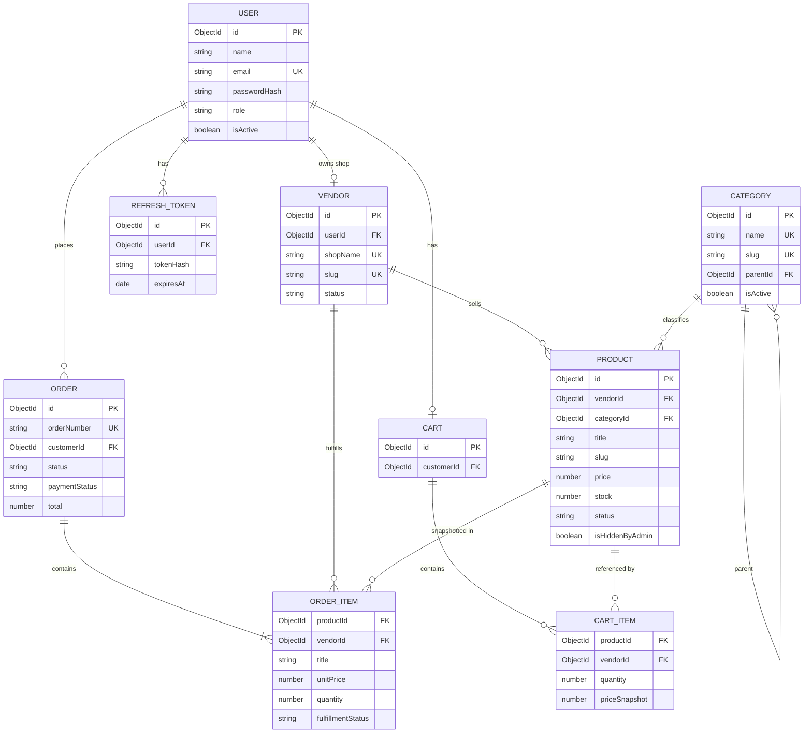

# ER Diagram — Phase 1

Logical relationships (MongoDB documents). Crow’s-foot style via Mermaid.

## Cardinality summary

| From | To | Cardinality | Notes |
| --- | --- | --- | --- |
| User | Vendor | 0..1 | One shop per user in Phase 1 |
| Vendor | Product | 1..N | Soft isolation by `vendorId` |
| User (customer) | Cart | 0..1 | One active cart |
| User (customer) | Order | 0..N | |
| Order | OrderItem | 1..N | May span multiple vendors |
| Category | Product | 1..N | |
| Category | Category | 0..N | Optional tree via `parentId` |
